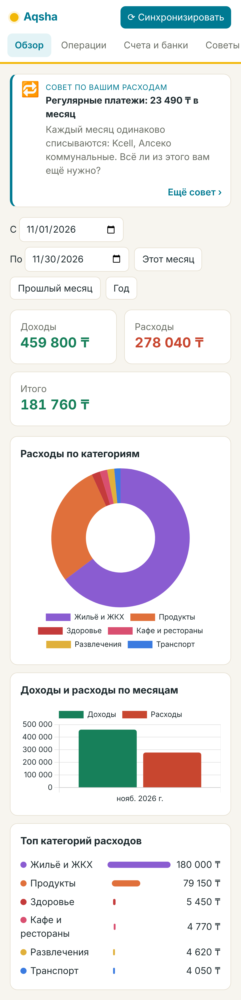
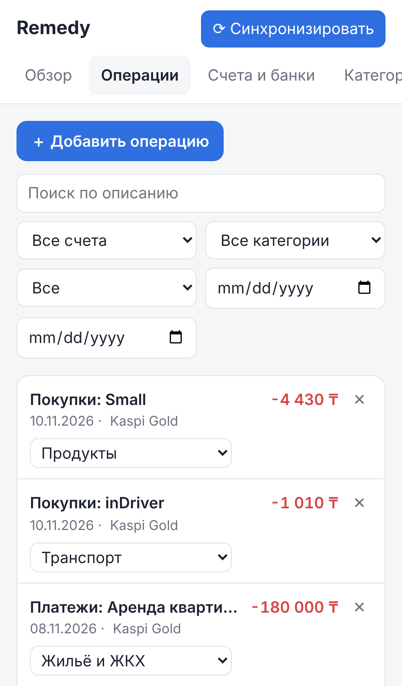
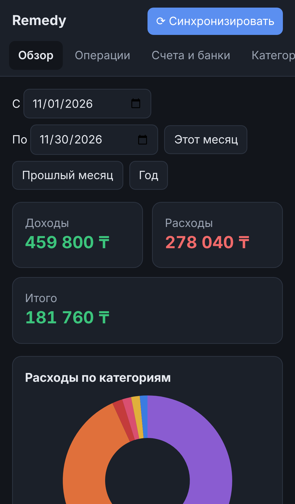
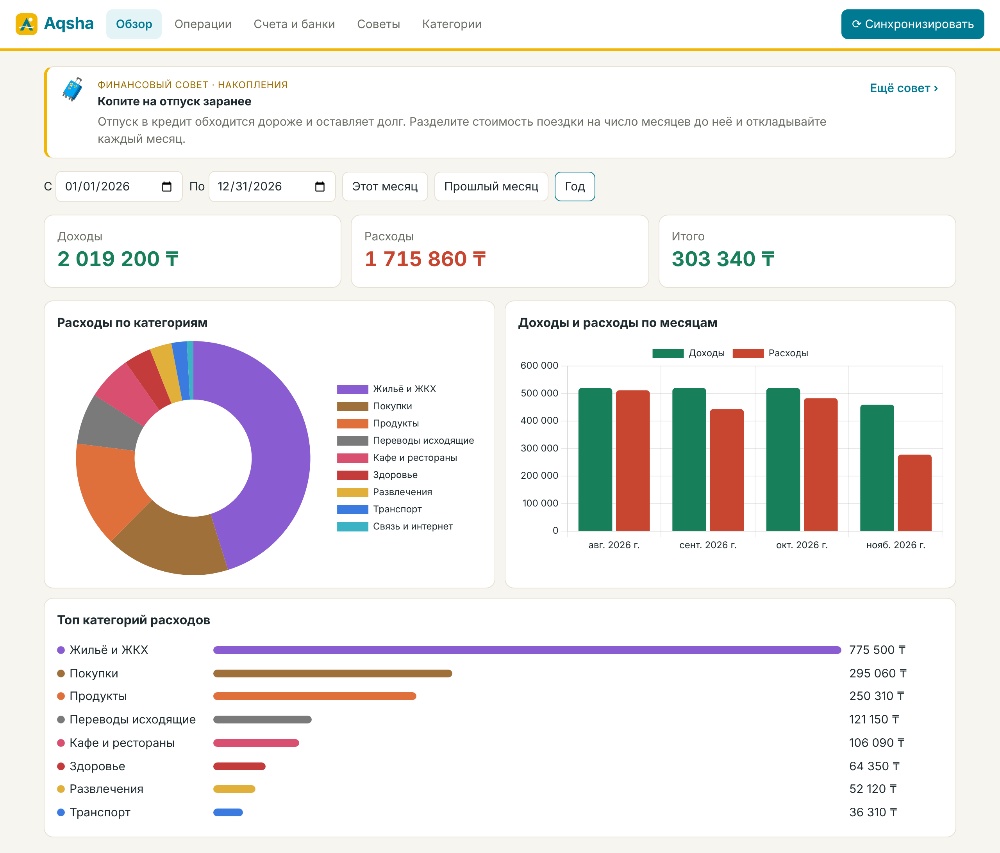

# Aqsha — учёт доходов и расходов


*Ақша* — по-казахски «деньги». Личные финансы в тенге: выписки Kaspi, автокатегории и советы.
<br clear="left">

Веб-приложение для личных финансов: операции сами подтягиваются из банка, раскладываются по категориям,
а на главной видно, сколько пришло, сколько ушло и на что.

<p>
  
  
  
</p>



## Возможности

- **Синхронизация с банком через Open Banking** (GoCardless Bank Account Data, ~2300 банков ЕС и Великобритании):
  вы входите в свой банк, подтверждаете доступ, и счета с операциями появляются в приложении.
  Дальше синхронизация идёт автоматически (по умолчанию раз в 6 часов) или по кнопке «⟳ Синхронизировать».
- **Импорт выписок Kaspi Bank (PDF)** — прямо из приложения Kaspi.kz, суммы в тенге (₸).
- **Импорт выписок CSV/OFX** — для любого банка, включая российские (Т-Банк, Сбер, Альфа и др.).
  Формат колонок определяется автоматически, кодировки UTF-8 и Windows-1251 поддерживаются.
- **Операции сразу, без выписки** — из уведомлений Kaspi (Android), Apple Wallet (iPhone) и быстрым вводом «кофе 1500».
- **Без дублей**: повторная синхронизация или повторный импорт той же выписки не создают копий операций.
- **Автокатегоризация** по правилам («Пятёрочка» → Продукты, «Яндекс Go» → Транспорт и т.д.).
  Если сменить категорию у операции и выбрать «запомнить», создаётся правило и применяется к похожим операциям.
- **Финансовые советы** на главной — каждый раз новые: личные, посчитанные по вашим операциям
  (сколько удалось отложить, какие категории выросли, регулярные платежи, размер подушки безопасности),
  и общие — подборка из ~120 советов по 12 темам (бюджет, накопления, долги, покупки, безопасность, доход,
  семья, инвестиции, привычки, налоги, ипотека, автомобиль). Общие советы работают даже без единой операции.
  Кнопка «Ещё совет ›» показывает следующий, без повторов; на вкладке «Советы» — вся подборка по темам.
- **Отчёты**: доходы, расходы и итог за период, диаграмма по категориям, график по месяцам.
- Счета вручную (например, «Наличные») и ручное добавление операций.
- **Демо-банк** — можно попробовать синхронизацию без ключей и настоящего банка.

## Запуск

```bash
python3 -m venv .venv && source .venv/bin/activate
pip install -r requirements.txt
uvicorn app.main:app --reload
```

Откройте http://localhost:8000. Чтобы быстро посмотреть приложение с данными: «Счета и банки» →
«Подключить банк» → выберите «Демо-банк» → «Найти банки» → нажмите на банк.

## Kaspi Bank

У Kaspi нет открытого API для выписок частных клиентов (Kaspi Pay API — только для продавцов), поэтому
полностью автоматической синхронизации нет. Зато выписку можно загрузить за минуту прямо с телефона:

1. Приложение **Kaspi.kz** → **Kaspi Gold** (или нужный депозит) → **Выписка**.
2. Выберите период (например, прошлый месяц) → **Поделиться** / **Сохранить** PDF.
3. В Aqsha: «Счета и банки» → «Импорт выписки» → выберите PDF → «Загрузить».

Счёт «Kaspi Gold» в тенге создастся автоматически. Можно загружать выписки с перекрывающимися
периодами — уже известные операции не задвоятся. Покупки в Magnum, Small, Galmart, Glovo, Wolt, ONAY,
Kcell/Beeline/Activ и т.п. распределяются по категориям автоматически.

Переводы между своими счетами Kaspi (Gold ↔ Депозит) попадут в «Переводы» — при желании удалите их
или заведите для них отдельную категорию, чтобы они не искажали доходы и расходы.

## Без выписки: уведомления Kaspi, Apple Wallet и быстрый ввод

Чтобы не ждать выписку до конца месяца, операции можно добавлять сразу:

- **Android** — приложение MacroDroid (или Tasker/Automate) пересылает текст каждого уведомления Kaspi.kz
  POST-запросом на ваш личный адрес `/api/ingest?token=…` (он показан на вкладке «Счета»).
  Aqsha сама находит сумму, тип операции и магазин: «Покупка 2 500 ₸ Magnum. Доступно …» → −2 500 ₸, Продукты.
- **iPhone** — «Команды» → «Автоматизация» → «Транзакция» (для карты в Apple Wallet) → «Получить содержимое URL»
  с JSON `{"amount": Сумма, "merchant": Продавец}`. Работает для оплат телефоном/часами.
- **Быстрый ввод** на вкладке «Операции»: «кофе 1500», «+450000 зарплата».

Когда в конце месяца вы загружаете PDF-выписку, операции из уведомлений **сливаются** с ней
(та же сумма, дата ±2 дня): описание берётся из выписки, а категория, поправленная вручную, сохраняется.
Быстрый ввод с выпиской не сливается — это часто наличные.

Телефон должен «видеть» Aqsha: та же Wi-Fi сеть, что и у компьютера, либо сервер. Адрес с ключом держите
в секрете; кнопка «Новый ключ» отключает старый адрес.

## Подключение банка через Open Banking (Европа)

1. Зарегистрируйтесь на https://bankaccountdata.gocardless.com и создайте ключи (User secrets).
2. Скопируйте `.env.example` в `.env`, впишите `GOCARDLESS_SECRET_ID` и `GOCARDLESS_SECRET_KEY`,
   и запустите с ними (`export $(cat .env | xargs)` или `uvicorn ... --env-file .env`).
3. В приложении: «Счета и банки» → провайдер «Open Banking» → код страны (DE, FR, GB, LT, …) → «Найти банки»
   → выберите банк. Вы попадёте на страницу банка, а после подтверждения вернётесь обратно со счетами.

Доступ, выданный банку по PSD2, обычно действует 90 дней — потом подключение нужно продлить, ещё раз пройдя шаг 3.

> **Про российские банки.** Сбер, Т-Банк, Альфа и другие пока не дают сторонним приложениям API для
> выписок частных клиентов, а GoCardless их не поддерживает. Для них используйте импорт выписки:
> - **Т-Банк**: приложение/сайт → Счёт → Выписка → «Выгрузить в CSV».
> - **Альфа-Банк**: Выписка → формат CSV/Excel (Excel сохраните как CSV).
> - **Сбербанк**: СберБанк Онлайн выдаёт выписку в PDF; для CSV подойдёт экспорт из «Сбербизнеса»
>   или ручное сохранение таблицы в CSV с колонками «Дата», «Сумма», «Описание».
> - Любой банк, отдающий **OFX/QFX**, импортируется без настроек.

## Как устроено

```
app/
  main.py          HTTP API (FastAPI) + раздача фронтенда, фоновая автосинхронизация
  db.py            схема SQLite, стандартные категории и правила
  sync.py          загрузка операций из банка: инкрементально, с перекрытием 5 дней, без дублей
  categorize.py    автокатегоризация по правилам
  banks/
    base.py        интерфейс провайдера (банки, подключение, счета, операции)
    gocardless.py  Open Banking через GoCardless Bank Account Data
    demo.py        демо-банк с тестовыми данными
    importers.py   разбор выписок CSV и OFX
    kaspi.py       разбор PDF-выписки Kaspi Bank
frontend/          одностраничный интерфейс (HTML/CSS/JS, графики — Chart.js)
tests/             тесты: `python3 -m pytest`
```

Новый банк или агрегатор (Plaid, Salt Edge, TrueLayer и т.п.) подключается реализацией четырёх методов из
`app/banks/base.py` и регистрацией в `app/banks/__init__.py`.

Данные хранятся локально в файле `aqsha.db` (если у вас уже есть `remedy.db` от прежней версии, он продолжит использоваться). Приложение рассчитано на одного пользователя на своём
компьютере: авторизации нет, поэтому не открывайте его в интернет без reverse-proxy с паролем.
